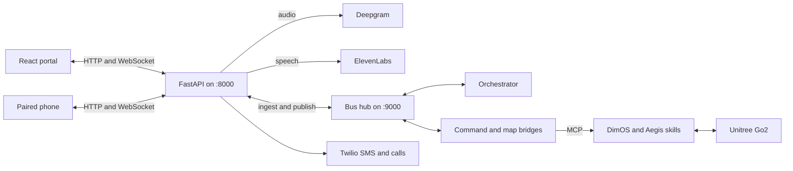

# Lantern

A caregiver portal and paired-phone voice check-in for a Unitree Go2 companion, built at HackMIT 2026.

Lantern is a 24-hour hackathon prototype (HackMIT 2026, September 19–20) for families supporting someone with dementia. A caregiver sets up the household in a web app, sends a spoken check-in to a paired phone, and watches Night Watch alerts, maps, and activity from the same event stream. Spoken robot requests can walk, follow, return home, or play a fixed set of Go2 actions when DimOS and the robot bridges are running. The phone is the microphone and speaker. It does not talk to the Go2 directly.

This repository is the finished hackathon build. The planning notes in [`docs/`](docs/) describe a wider product than the code implements. The robot skill package still uses the earlier name **Aegis**.

## Features

- **Caregiver portal** (`cloud/web`): onboarding, household check-ins, daily routine editing, Night Watch, 2D zone map, 3D point-cloud viewer, alerts, activity timeline, and a scripted demo walk.
- **Paired phone** (`voice/`): QR pairing, WebSocket delivery, ElevenLabs playback, a five-second reply recording after a check-in, typed replies, and a separate ten-second robot-request control.
- **Speech**: Deepgram transcription of a finished recording (`nova-3` by default). ElevenLabs synthesis (`eleven_flash_v2_5` by default), including an optional onboarding voice sample uploaded to ElevenLabs `/v1/voices/add`.
- **Check-in dialogue**: one fixed acknowledgment, plus keyword flagging for words such as “help”, “pain”, and “scared”.
- **Robot requests**: phrase matching in `orchestrator/lantern_orch/intent.py` (walk, follow, home confirmation, stop, and named sport actions such as sit, stand, wave, dance, jump, and flip). The command bridge calls DimOS MCP tools.
- **Companion skills** (`hackmitdog/aegis/`): named locations, relative navigation, person follow, guided routes, danger-zone geometry, object-location memory, home navigation, and room mapping.
- **Night Watch**: zone and track events drive `IDLE`, `ATTEND`, `LEAD`, `ESCALATE`, and `EMERGENCY`, plus walk states `WALK`, `FOLLOW`, `CONFIRM_HOME`, and `GUIDE_HOME`. Alerts can escalate to Twilio SMS and calls. Acknowledgement cancels the ladder.
- **Hardware-free demo**: `orchestrator/run_spine.py` runs the bus, mocks, state machine, and cloud bridge. Onboarding can also load a schematic floor plan.

## Tech stack

| Layer | Stack |
|---|---|
| Portal | React 19, TypeScript, Vite, Tailwind CSS 4, React Router |
| Cloud API | FastAPI, Uvicorn, Pydantic. JSONL event log and an in-memory projection |
| Voice | FastAPI, mounted on the cloud app at `/voice`. Deepgram and ElevenLabs over HTTP |
| Bus | FastAPI hub: `POST /publish`, WebSocket `/ws` |
| Orchestrator | Python state machine, mocks, breadcrumb recorder |
| Robot | Separate processes call `dimos mcp`. Skills are DimOS blueprints in `pyproject.toml` |
| Notifications | Twilio Python helper. Missing credentials log a dry run |

Python **3.12+** (`pyproject.toml`). The portal build was run here on Node **22.23.3** with Vite 8. DimOS and a Go2 are required only for live robot and live mapping.

## Architecture



Vite on port **5173** proxies `/api`, `/ws`, and `/voice` to the API, so one HTTPS tunnel serves the portal and the phone. The bus hub listens on port **9000**. The orchestrator posts events to `POST /api/ingest`. Cloud appends them to JSONL, updates its projection, and broadcasts a snapshot plus live events to the portal.

Shared envelopes use `type`, `ts`, `source`, `seq`, and `payload`. Types include `person_track`, `pose`, `agent_state`, `command`, `robot_status`, `say`, `transcript`, `alert`, and `caregiver_ack`. The contract is [`docs/04-interfaces.md`](docs/04-interfaces.md). Map coordinates are metres, origin at the south-west corner of the taped area, +x east ([`docs/16-e3-portal.md`](docs/16-e3-portal.md)).

## Project structure

```text
cloud/server/          API, projection, alerts, reports, voice mount
cloud/web/             React portal
cloud/fixtures/        Demo event stream and sample map payload
voice/                 Phone UI, providers, dialogue, session relay
bus/                   Envelope, pub/sub, HTTP/WebSocket hub
orchestrator/          State machine, intents, mocks, spine runner
robot/                 DimOS command and map bridges
hackmitdog/aegis/      Companion skills and blueprint entry points
artifacts/maps/        Captured PLY maps and JSON sidecars
docs/                  Original product, safety, and interface notes
```

## Setup

From the repository root:

```bash
python3 -m venv .venv
source .venv/bin/activate          # Windows: .venv\Scripts\Activate.ps1
python -m pip install -r cloud/requirements.txt -r voice/requirements.txt -r orchestrator/requirements.txt -r bus/requirements.txt
npm --prefix cloud/web ci
```

Copy the templates and fill in only the services you use. Do not commit the copies.

```bash
cp voice/.env.example .env         # repository-root file; voice loads this path
cp cloud/.env.example cloud/.env
```

`voice/app.py` loads the root `.env` with `override=True`. `cloud/server/notify.py` loads `cloud/.env`. The orchestrator and robot bridges read process environment variables and do not load a dotenv file.

### Environment variables

**Repository-root `.env`** (see [`voice/.env.example`](voice/.env.example)):

| Name | Role |
|---|---|
| `DEEPGRAM_API_KEY` | Server-side transcription. Without it, the phone can use browser speech recognition or typed input |
| `DEEPGRAM_MODEL` | Default `nova-3` |
| `ELEVENLABS_API_KEY` | Synthesis and voice enrollment |
| `ELEVENLABS_VOICE_ID` | Default voice |
| `ELEVENLABS_VOICE_CONSENT` | Must be `true` before synthesis uses the configured voice |
| `ELEVENLABS_MODEL_ID` | Default `eleven_flash_v2_5` |

**`cloud/.env`** (see [`cloud/.env.example`](cloud/.env.example)):

| Name | Role |
|---|---|
| `TWILIO_ACCOUNT_SID`, `TWILIO_AUTH_TOKEN`, `TWILIO_FROM_NUMBER`, `TWILIO_TO_NUMBER` | SMS and calls. Empty values dry-run to the log |
| `TWILIO_TO_JENNY`, `TWILIO_TO_MARK` | Optional overrides. The ladder calls contact id `jenny`, then `mark` |
| `TWILIO_TRIAL`, `TWILIO_TRIAL_TEMPLATE` | Trial accounts send a Twilio template name. `TWILIO_TRIAL=0` sends the alert text |
| `MAP_SCAN_MODE` | Default when a caller omits mode. The onboarding **Start mapping** button sends `live`; **Use demo map** sends `demo` |
| `LANTERN_MAP_ARTIFACT_DIR` | Directory served at `/api/maps/<filename>`. Default `artifacts/maps` |
| `LANTERN_MAP_DURATION_S` | Expected scan length, default `180` |
| `LANTERN_FAST_LADDER` | `1` shortens alert delays from 60s/120s to 8s/16s |
| `LADDER_L3_AFTER_S`, `LADDER_L4_AFTER_S` | Override those delays when fast ladder is off |
| `ACK_BASE_URL` | Origin embedded in ack links. Default `http://127.0.0.1:8000`. Use the public tunnel origin when the link must open on a phone |
| `LANTERN_ORCH_PUBLISH_URL` | Bus base URL, usually `http://127.0.0.1:9000`, so transcripts and acks reach the orchestrator |
| `DOG_CAMERA_ENABLED`, `DOG_CAMERA_URL`, `DOG_CAMERA_STREAM_URL` | On-demand camera panel. Off unless enabled |

**Portal** (copy [`cloud/web/.env.example`](cloud/web/.env.example) to `cloud/web/.env.local`):

| Name | Role |
|---|---|
| `VITE_PUBLIC_ORIGIN` | HTTPS origin for QR codes when the browser is on localhost and a tunnel is up |
| `VITE_WS_URL` | Optional WebSocket override. Unset uses the page origin plus `/ws` |

**Orchestrator process** (export in that shell):

| Name | Role |
|---|---|
| `LANTERN_FAST_SPINE` | Default `1`. Lead-to-escalate timer is 5s when set, 20s otherwise |
| `LEAD_TO_ESCALATE_S`, `TTZ_LEAD_S` | Timer overrides. Time-to-zone lead default is 8s |
| `BREADCRUMB_SPACING_M` | Trail spacing, default `0.5` |

**Map bridge process**: `LANTERN_MAP_DURATION_S`, `LANTERN_MAP_MCP_TIMEOUT_S` (default `300`).

**Browser smoke tests**: `BROWSER_CHANNEL`.

Robot connection values such as `ROBOT_IP` and `UNITREE_AES_128_KEY` belong to the DimOS install, not this API.

## Run

Use one API worker. Sessions and the live projection are process-local.

```bash
# Terminal 1
source .venv/bin/activate
python -m uvicorn main:app --app-dir cloud/server --host 127.0.0.1 --port 8000

# Terminal 2
npm --prefix cloud/web run dev
```

Open `http://127.0.0.1:5173`.

| Path | Screen |
|---|---|
| `/` | Welcome |
| `/onboarding` | Person, map, zones, routine |
| `/watch` | Night Watch dashboard |

Voice health is `GET /voice/api/health`. The cloud process already mounts voice. A second `voice.app` server on port 8000 will conflict with it.

### Phone

Microphone access needs HTTPS on a real phone. With the API and Vite running:

```bash
cloudflared tunnel --protocol http2 --url http://127.0.0.1:5173
```

Set `VITE_PUBLIC_ORIGIN` in `cloud/web/.env.local` to that origin, set `ACK_BASE_URL` in `cloud/.env` to the same origin when ack links should be opened off-machine, and restart Vite and the API. On the phone, open the pairing link and tap **Start Lantern**. Hiding the page pauses the session. Sessions expire after 12 hours and disappear when the API restarts. Only one phone can join a session.

### Mock Night Watch

With the API already on port 8000:

```bash
python orchestrator/run_spine.py --scenario exit_seeking
```

The spine starts its own bus hub on port 9000, then exits after the scenario. For a longer session: `python orchestrator/run_spine.py --scenario calm --hold 3600`. The dashboard also has a scripted demo walk. Run the live robot consumer on a different bus from `MockRobot`.

Replay a fixture without the spine:

```bash
python cloud/server/replay.py --fixture cloud/fixtures/exit_seeking.jsonl --rate 4
```

### Spoken robot requests

Recognized phrases include “go on a walk”, “follow me”, “take me home”, “yes” / “no” while a home confirmation is pending, “stop”, and the sport phrases in `intent.py` (`sit`, `stand up`, `wave`, `dance`, `jump`, `front flip`, and the rest of `TRICKS`). **Stop speaking** on the phone stops audio. It is a separate control from the robot `stop` command.

For hardware, on the API machine:

```bash
python bus/run_hub.py --port 9000
python orchestrator/run_orchestrator.py --bus-url ws://127.0.0.1:9000/ws --cloud http://127.0.0.1:8000
```

On the machine that has DimOS, install this repo into that environment (`python -m pip install -e .` or `uv pip install -e .`) and run one blueprint. `hackmitdog.breadcrumb` is the non-LLM combined blueprint. `hackmitdog.aegis-breadcrumb-agentic` adds an MCP client and needs that blueprint’s model provider. Pass the robot address and AES key your DimOS version expects. Then:

```bash
python robot/dimos_command_bridge.py --bus-url ws://127.0.0.1:9000/ws --dimos-bin dimos
python robot/dimos_map_bridge.py --bus-url ws://127.0.0.1:9000/ws --cloud-base http://127.0.0.1:8000 --artifact-dir artifacts/maps --artifact-base /api/maps
```

`take_me_home` publishes the first recorded pose to the DimOS planner. It uses the current costmap. The skill does not replay the trail in reverse. The command bridge handles follow, home, stop-follow, and named sport commands. Other Night Watch commands, including `lead_to`, are outside that bridge.

More detail: [`robot/README.md`](robot/README.md), [`robot/VOICE_WALK_RUNBOOK.md`](robot/VOICE_WALK_RUNBOOK.md), [`AEGIS_SKILL_TESTING.md`](AEGIS_SKILL_TESTING.md).

### Camera

Set `DOG_CAMERA_ENABLED=1` and either `DOG_CAMERA_URL` (a page the browser can iframe) or `DOG_CAMERA_STREAM_URL` (a stream the API can proxy). The panel stays closed until a caregiver opens it. Frames are not posted to `/api/ingest`. See [`robot/CAMERA_DIAGNOSTICS.md`](robot/CAMERA_DIAGNOSTICS.md).

## Tests

```bash
python -m unittest discover -s voice/tests -v
python -m unittest discover -s orchestrator/tests -v
python -m unittest cloud.scripts.test_voice_clone -v
PYTHONPATH=robot python -m unittest discover -s robot/tests -v
npm --prefix cloud/web run lint
npm --prefix cloud/web run build
```

Checked on Python 3.12 with the four requirements files above, and Node 22:

| Command | Result |
|---|---|
| `voice/tests` | 25 passed, 1 failed, 2 errors. `test_walk_home_confirmation_and_stop_with_mock_robot` expects one forwarded transcript and sees 64. `test_playback_handoff` and `test_robot_phone_ui` import Playwright, which is only in `voice/requirements-dev.txt` |
| `orchestrator/tests` | 4 passed, 2 errors. Both call `RemoteBus._dispatch_if_new`, which the class does not define |
| `cloud.scripts.test_voice_clone` | 3 passed |
| `robot/tests` | 5 passed |
| `npm run lint` | exits 0, with oxlint warnings in `Map3D.tsx` and `MorningReport.tsx` |
| `npm run build` | passes (`tsc -b` and Vite) |

`python -m voice.check_providers` and the Playwright scripts under `voice/tests/` call live speech APIs or a browser. They are optional.

`hackmitdog/aegis/test_danger_zone_geometry.py` is a geometry script next to the skill, not part of the unittest discovery paths above.

## Team

Names follow git author names. Handles are used where the commits do not record a full name.

- Ally Chen
- Javi
- Lamine (goldensnub)
- Alex (alwxngn; one commit is authored as 28anguyen on the same email)

## Known limitations

- Check-in replies are the fixed sentence in `voice/dialogue.py`. Keyword hits flag the transcript for the caregiver. There is no conversational model in the phone service.
- Transcription waits for a completed upload. Check-in recordings stop after five seconds, robot requests after ten seconds, and uploads over 5 MiB are rejected.
- Phrase matching covers the phrases in `intent.py`. It has a small confirmation vocabulary and does not handle open-ended requests.
- Pairing uses per-session tokens. Portal, ingest, and bus routes do not have user accounts.
- Configuration, sessions, and the live projection are in memory. Restarting the API drops them. The JSONL log is an event record, not a full restore.
- Onboarding contacts and the preset household are portal data. Twilio destinations come from `TWILIO_TO_*`. The call flow has no DTMF webhook; acknowledgement is the portal or `/api/ack`.
- `orchestrator/run_orchestrator.py` still publishes a startup config whose patient name is Arthur. The portal and cloud defaults use Susan. Apply the household config after the orchestrator starts if those processes run together.
- Voice enrollment stores the provider voice id after a successful upload. Synthesis still requires `ELEVENLABS_VOICE_CONSENT=true`. There is no separate revocation flow.
- Routine completion ticks live in the browser. Saving a routine writes config. It does not schedule speech on its own.
- Live map files have to be in the API’s artifact directory. An `artifact_url` string does not copy the file.
- Physical yielding, collision avoidance, and emergency stop are the robot runtime’s job. Mock scenarios do not establish that behavior.
- The voice pipeline test and the two remote-bus tests in the table above fail on the current program. The pipeline forwards the same transcript many times. The bus tests call a method the refactor removed.

## License and citations

Open-source libraries are listed in [`CREDITS.md`](CREDITS.md). Robot skills build on [DimOS](https://github.com/dimensionalOS/dimos) and Unitree Go2 hardware.

Subsystem notes: [`cloud/README.md`](cloud/README.md), [`voice/README.md`](voice/README.md), [`bus/README.md`](bus/README.md), [`orchestrator/README.md`](orchestrator/README.md), [`robot/README.md`](robot/README.md).
